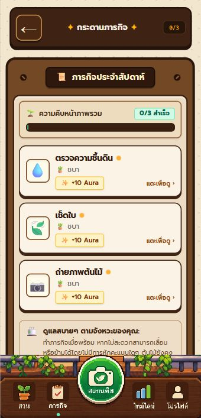
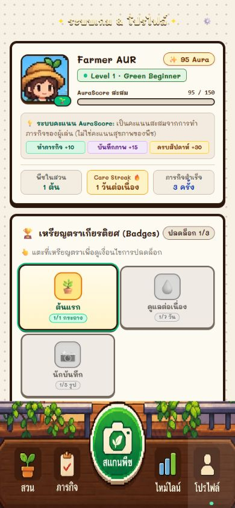

# AuraFarming

A pixel-style plant care web app for identifying plants and keeping a simple care routine.


## Overview

AuraFarming is a university seminar project for people who want help identifying a plant and remembering how they care for it. It combines a small virtual garden with real plant records, care activities, and growth photos. The app interface is in Thai.

Pl@ntNet identifies plants from photos and returns candidate species and confidence scores. Gemini provides Thai names and care guidance for those species, while a curated lookup takes precedence for known Thai names. It cannot change the species or confidence returned by Pl@ntNet.

## Key Features

- **Personal garden:** email or Guest sessions, in-game farm naming, and private plant records.
- **Plant identification:** camera or image upload, candidate selection, and confidence warnings.
- **Care guidance:** Thai names and species-specific advice, with an explicit notice when advice is unavailable.
- **Care tracking:** soil checks, watering records, weekly missions, and rewards.
- **Growth timeline:** save photos and notes, and compare earlier and later images.
- **Garden management:** add plants manually, rename them, change placement, or archive them.
- **Progress:** accumulated Aura, care streaks, and badges. Plant Match Score separately estimates placement suitability.

These features are implemented in source. The [live verification report](docs/reports/LIVE-FEATURE-VERIFICATION-2026-10-30.md) distinguishes browser checks from API checks and lists what remains unverified; not every feature has a complete browser/device test.

## Tech Stack

| Layer | Technologies |
| --- | --- |
| Frontend | React 19, TypeScript, Vite 8, Tailwind CSS 4 |
| Backend | Supabase Auth, Storage, and Deno Edge Functions |
| Database | PostgreSQL with row-level security and SQL functions |
| Plant services | Pl@ntNet for identification; Gemini for Thai names and care |
| Validation and tests | Zod, Node test runner, happy-dom, PGlite, Deno tests |

## Screenshots

Existing development captures of the running interface. They show earlier revisions, so layout and displayed progress may differ from the current build. They are not generated portfolio mockups.

<p>
  
  
</p>

[Browse the screenshot archive](docs/screenshots/README.md). The separate [portfolio export](exports/portfolio/README.txt) is a labelled presentation mockup, not a product screenshot.

## Getting Started

Use Node.js 22.12 or later and npm. Development checks have been run with Node.js 24.

```bash
git clone https://github.com/tharitten1234/aurafarming.git
cd aurafarming
npm ci
```

Copy [`.env.example`](.env.example) to `.env.local` and set the URL and publishable key for a configured Supabase project:

```dotenv
VITE_SUPABASE_URL=https://your-project.supabase.co
VITE_SUPABASE_PUBLISHABLE_KEY=your-publishable-key
```

Keep provider API keys and the Supabase service-role key on the server. The [setup guide](docs/SETUP.md) covers database migrations, Auth providers, Edge Function secrets, and deployment.

```bash
npm run dev
```

Open [localhost:3000](http://localhost:3000), or the URL printed by Vite if that port is already in use.

### Checks and Build

```bash
npm run lint
npm test
npm run check:edge
npm run test:edge
npm run build
```

`lint` runs the TypeScript checker. Production files are written to `dist/`; use `npm run preview` to inspect that build locally.

With the development server running, `npm run check:presentation` performs optional, read-only connection checks. It does not call the AI providers or verify their remaining quota.

## Project Structure

```text
src/                 Screens, shared types, and client services
public/              Runtime artwork and static assets
supabase/            SQL migrations and Edge Functions
tests/               Domain, database, and component tests
scripts/             Connection checks and hosted test utilities
docs/                Setup, reports, screenshots, and historical notes
exports/portfolio/   Labelled presentation material
```

Start with the [documentation index](docs/README.md) for technical notes and reports.

## Project Status

**Student MVP with verified core workflows.** The latest recorded live check is dated 30 October 2026. Automated checks cover 13 frontend/domain/database cases and 8 Edge cases; mocked tests do not replace device or hosted-service testing.

- Physical phone cameras, real email delivery, and the complete email-confirmation flow still need separate verification.
- Google sign-in depends on provider configuration and was disabled in the latest recorded live check.
- AI advice can be unavailable or incorrect. Provider confidence is not a measured project accuracy rate.
- Plant Match Score uses declared light and placement; it is not a sensor reading or plant health diagnosis.
- Photo rewards come from completing an eligible weekly mission, not from every upload. Some existing screen labels still use the older AuraScore wording.
- Growth comparison is manual. Disease diagnosis and push reminders are not implemented.

See the [verification report](docs/reports/LIVE-FEATURE-VERIFICATION-2026-10-30.md) and [dated code review](docs/reports/CODE-REVIEW-REPORT-2026-10-30.md) for evidence and remaining work.

The [system alignment check](docs/SYSTEM-ALIGNMENT.md) identifies remaining legacy template values, UI wording, and differences between the documentation draft and the published branch.

## Credits

- [tharitten1234](https://github.com/tharitten1234) — repository maintainer; application integration and verification work are recorded in the Git history.
- The base UI and pixel artwork were supplied in a project archive. The original creators and asset licensing are not identified in the available project records; no additional contributor roles are assumed.
- Pl@ntNet supplies plant identification; Google Gemini supplies generated care guidance. [Thai name references](docs/THAI-PLANT-NAMES.md) document the curated name lookup.
